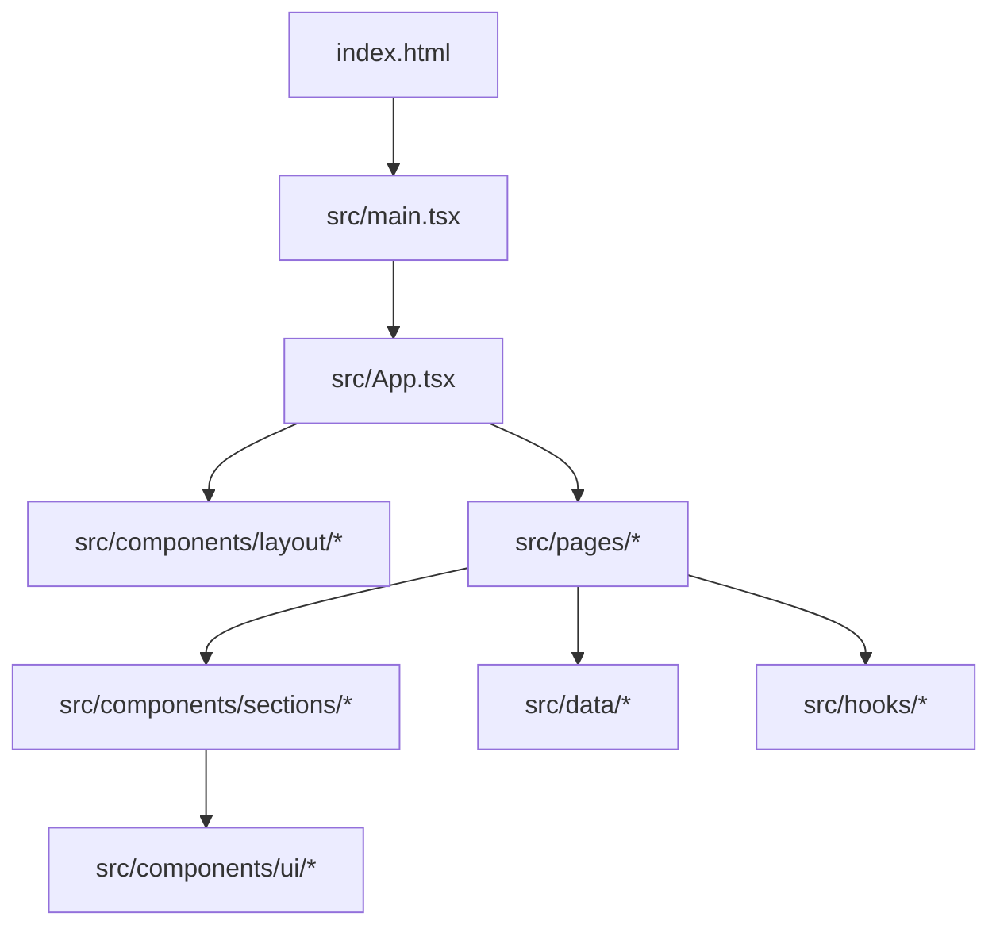

# 📁 Repository & Directory Structure

This document outlines the codebase layout of **Finovia**, explaining the architectural design and directory hierarchy.

---

## 🏛️ Overall Architecture

Finovia is designed as a single-page application (SPA) with a component-driven architecture. The project is organized to separate concerns cleanly between UI presentation, layout containers, custom hooks, and static configurations.

---

## 📂 Directory Breakdown

### 📂 Root Directory
The root directory houses build, compilation, and dependency configurations.

| File / Folder | Purpose |
| :--- | :--- |
| `src/` | Main React application source code. |
| `public/` | Static assets like icons, logos, and configuration files served directly. |
| `docs/` | Comprehensive technical documentation (this directory). |
| `index.html` | Entry-point HTML file. Vite injects the client scripts here. |
| `package.json` | Project metadata, scripts, and dependency definitions. |
| `vite.config.ts` | Configuration for Vite bundler, path aliases (`@/*`), and build output. |
| `tsconfig.json` | TypeScript compilation rules and absolute path resolutions. |
| `components.json` | Configuration file for `shadcn/ui` components setup. |
| `.gitignore` | Prevents local dependencies, build artifacts, and environment secrets from being committed. |

---

### 📂 Source (`src/`) Directory

#### `src/main.tsx`
The bootstrap file that renders the React root component (`App.tsx`) and attaches it to the DOM.

#### `src/App.tsx`
The primary router component using `wouter`. Orchestrates the layout structure, lazy routes, and wrapper providers (React Query, Tooltip, ThemeProvider, Toaster).

#### 📂 `src/components/`
Modular UI pieces grouped by their role:
*   **`layout/`**: Global layout components like the `navbar.tsx`, `footer.tsx`, and `page-loader.tsx`.
*   **`sections/`**: Feature-rich content layouts that compose individual pages (e.g., `hero-section.tsx`, `loan-tools.tsx`, `dashboard-preview.tsx`).
*   **`ui/`**: Base design-system components generated via `shadcn/ui` (e.g., buttons, dialogs, charts, tables).
*   **`theme-provider.tsx`**: Manages the application's light/dark mode states.

#### 📂 `src/pages/`
Represents individual page views tied directly to routing.
*   `home.tsx`: Finovia home page displaying the hero and primary onboarding paths.
*   `about.tsx`: Information about Finovia's vision, history, and executive team.
*   `accounts.tsx`: View showcasing checkings, savings, and card products.
*   `business.tsx`: Custom accounts, treasury, and commercial credit services.
*   `contact.tsx`: Form for customer support and office locations.
*   `finovia.tsx`: Interactive dashboard demo showcasing financial analytics and mock account activities.
*   `not-found.tsx`: Fallback component when users hit unregistered routes.

#### 📂 `src/data/`
Holds static text data and constants to keep the page components clean and maintainable.
*   Contains data models for navigation, account tier tables, interest calculations, security guidelines, and business tools.

#### 📂 `src/hooks/`
Custom hooks capturing reusable logic:
*   `use-local-storage.ts`: Automatically synchronizes state to localStorage.
*   `use-mobile.tsx`: Tracks window size to adjust UI layouts dynamically for mobile screens.
*   `use-page-meta.ts`: Easily sets page headers and metadata dynamically.
*   `use-toast.ts`: Hook controller for spawning toast notifications.

#### 📂 `src/lib/`
*   `utils.ts`: Contains the standard `cn` utility function combining `clsx` and `tailwind-merge` for safe dynamic class names.
